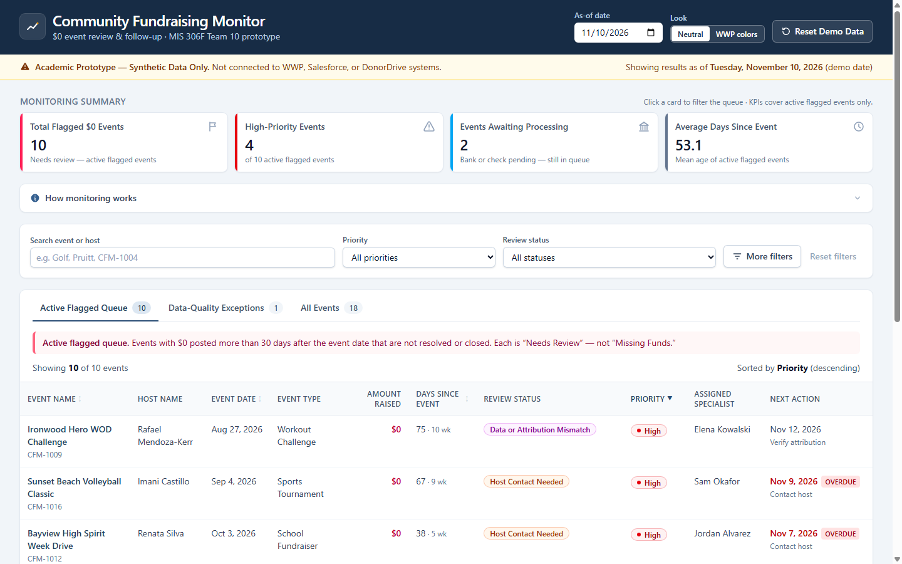
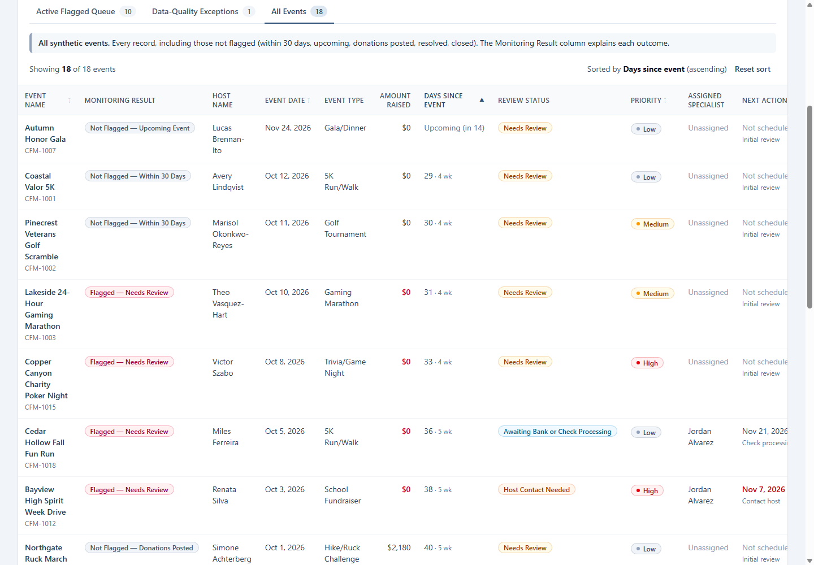
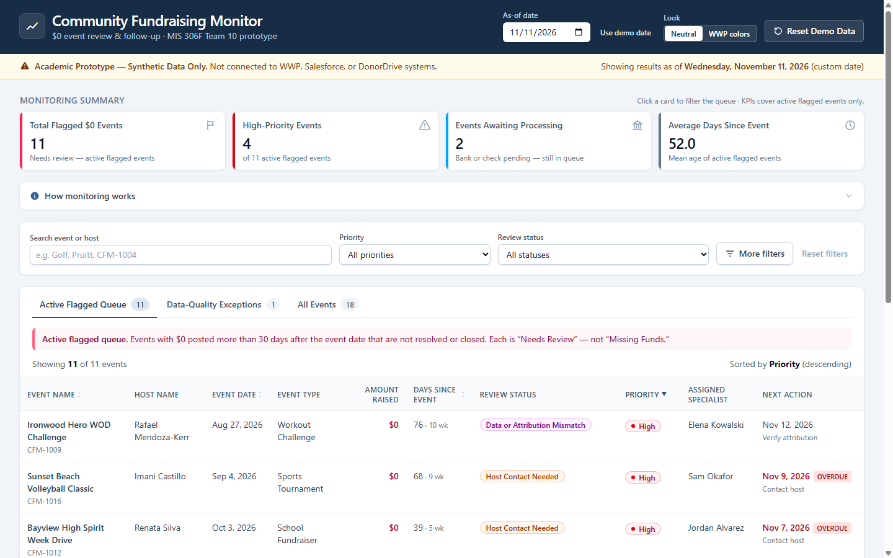
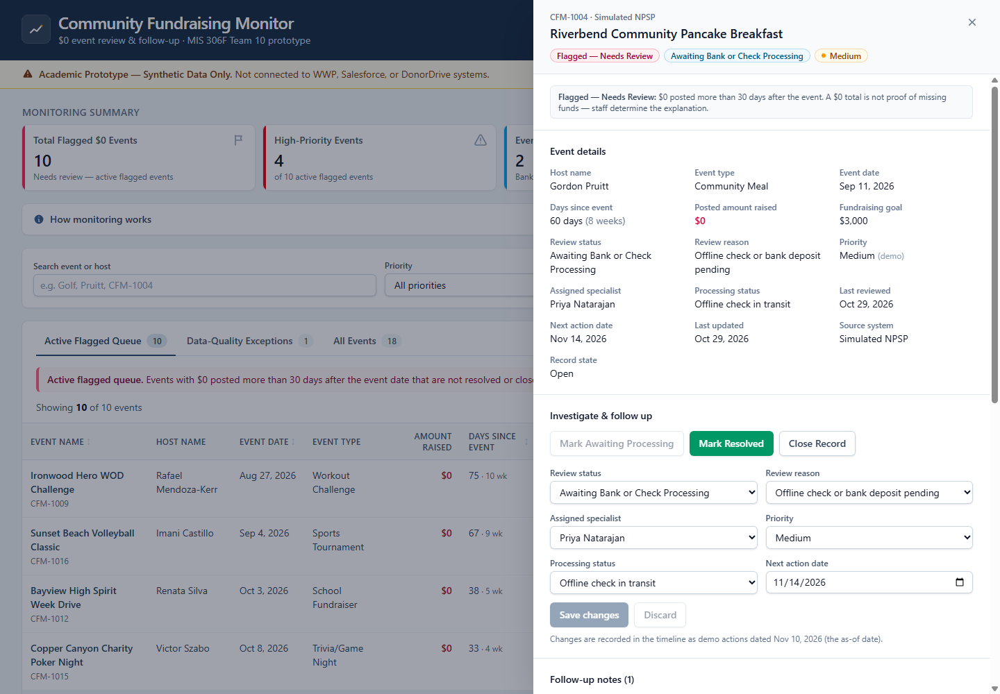
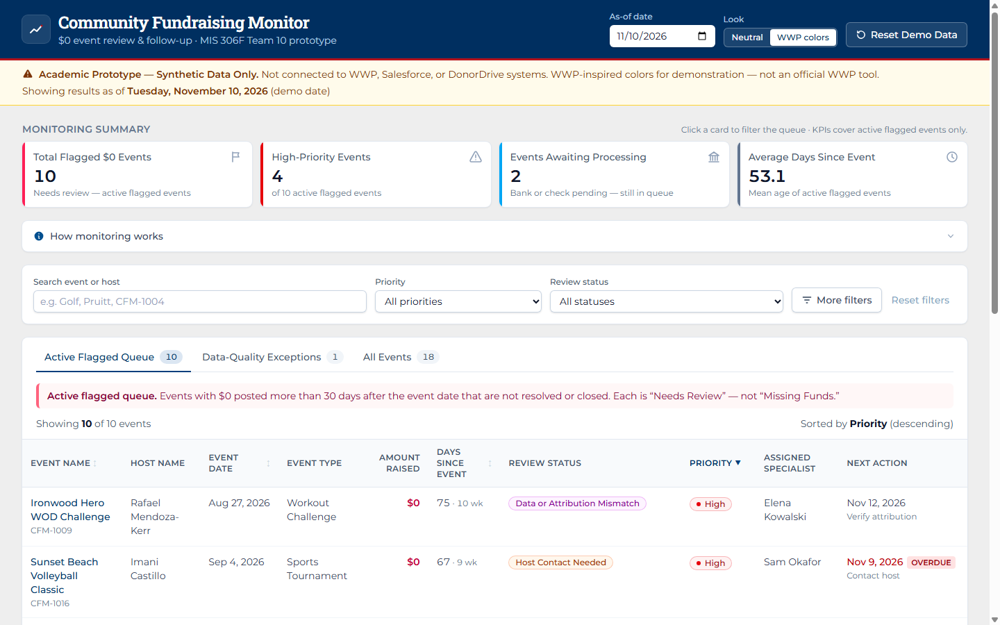

# Team Review — Community Fundraising Monitor (first prototype)

**For:** MIS 306F Team 10 · **Prepared:** Nov 10, 2026

**Live demo:** https://wwp-dashboard.netlify.app (once the Netlify deploy finishes)
**Code:** https://github.com/difrodar/WWP_Dashboard_PT

Everything in the app is fictional. It is not connected to WWP, Salesforce, or DonorDrive. Your clicks are saved only in your own browser, so experiment freely; nobody else sees your changes. **Reset Demo Data** (top right) puts everything back.

---

## 1. What the prototype does (30-second version)

The dashboard finds community fundraising events that still show **$0 more than 30 days after the event date**. It marks them **"Needs Review"**, never "Missing Funds". Staff then investigate, prioritize, assign, write notes, schedule follow-up, and resolve. In our process model, it covers **3.0 Monitor**, **4.0 Investigate & Prioritize**, and **5.0 Contact & Follow Up**.

---

## 2. Demo script (about 7 minutes)

> **Before you start:** click **Reset Demo Data → Reset demo data**, so the numbers below match.

| # | Do this | Say this | You should see |
|---|---|---|---|
| 1 | Open the app | "Staff land on the active queue: only events with $0, more than 30 days old, not resolved or closed." | KPIs **10 / 4 / 2 / 53.1**, 10 rows |
| 2 | Point at the amber banner and the as-of date | "Synthetic data only. The as-of date is our 'today', fixed so every demo gives the same results." | *As of Tuesday, November 10, 2026* |
| 3 | Click the **All Events** tab, then click **Days Since Event** twice (▲ ascending) | "Here are the boundary cases. 29 and exactly 30 days are *not* flagged; 31 is." | Autumn Honor Gala *Upcoming*, Coastal Valor 5K *29*, Pinecrest Golf *30*, Lakeside Gaming *31 → Flagged* |
| 4 | Change the **As-of date** to **11/11/2026** | "Move one day forward and the 30-day event crosses the line. Everything recalculates." | Total flagged **11**; Pinecrest now flagged. Click **Use demo date** to go back. |
| 5 | Click the **Data-Quality Exceptions** tab | "A missing event date can't be evaluated, so it goes to a separate queue instead of being guessed." | Heroes Hoops 3-on-3, *Missing date* |
| 6 | Back on **Active Flagged Queue**, open **Riverbend Community Pancake Breakfast** | "$0 isn't proof of a problem. Here the host mailed a check, and offline gifts take weeks. It stays in the queue but is clearly labeled." | Status *Awaiting Bank or Check Processing*, processing *Offline check in transit*, note from Priya |
| 7 | Close it (✕ or Esc). Open **Copper Canyon Charity Poker Night** (High, unassigned) | "A new high-priority case nobody owns yet." | Specialist *Unassigned* |
| 8 | In *Investigate & follow up*, set **Assigned specialist → Elena Kowalski**, **Review status → Host Contact Needed**, and a **Next action date**, then click **Save changes** | "Each change is logged in the timeline as a demo action." | Green toast; new timeline entries |
| 9 | Type a note, then click **Add note** | "Notes stay with the case. Nothing is emailed; that would be a future component." | Note at the top of the notes list |
| 10 | Open **Lakeside 24-Hour Gaming Marathon** and click **Mark Awaiting Processing** | "Waiting on a check doesn't remove it from the queue." | *Events Awaiting Processing* **3**; total still **10** |
| 11 | Click **Mark Resolved** | "Only resolving or closing removes a case." | Total flagged **9**; it disappears from the queue but stays in **All Events** as *Not Flagged — Resolved* |
| 12 | Refresh the browser page, then **Reset Demo Data** | "Changes persist for the demo and can be reset." | After refresh still **9**; after reset back to **10** |
| 13 | Click the **High-Priority Events** card, then click it again | "The cards double as shortcuts. One click shows only the urgent cases." | 4 rows with the card outlined, then back to 10. *Days Since Event* shows days and weeks, e.g. `75 · 10 wk`, as Tristin asked |
| 14 | In the header, switch **Look** from *Neutral* to **WWP colors** | "This is how it could look in WWP's palette. No logo, and it's still marked as not an official tool." | Navy header with a red accent line, Montserrat/Roboto Slab fonts, and the extra disclaimer sentence |

Screens for steps 3, 4, and 6:

Step 14, the "WWP colors" look:

More: [data-quality tab](screenshots/05-data-quality-exceptions.png) · [phone layout](screenshots/06-mobile.png)

---

## 3. Decisions we need from the team

Please come with an opinion on each. Item 1 blocks further work; the rest shape the next version.

1. **Is the $0-fundraiser scope confirmed?**
   Our earlier client notes focused on *donation-reference matching* (connecting incoming donations to the right fundraiser). The $0-event direction still needs explicit OK from Professor Meader / WWP. Should we keep building this, or pivot?

2. **Tristin's requested fields — confirmed, no decision needed.** Tristin asked for:
   - Event Name
   - Host Name (Registrant)
   - Event Date
   - Type of Event
   - events more than 30 days past that are still at **$0**
   - as a bonus, a **days/weeks since event** column for prioritizing

   All of these are in the table and the detail view. Tristin also named the same legitimate delays we model: advisory board, bank, and post-event donations. Tristin asked whether anything was missing. Our extra fields (review status/reason, priority, specialist, next action) are a good topic to raise in our reply.

3. **Review statuses.** We currently have eight:
   - Needs Review
   - Awaiting Bank or Check Processing
   - Awaiting Advisory Board
   - Post-Event Donations Expected
   - Host Contact Needed
   - Data or Attribution Mismatch
   - Confirmed No Activity
   - Resolved or Funds Attributed

   Keep, rename, merge, or add? Should we ask WWP for their real terms?

4. **Review reasons and processing statuses.** These are our own demo lists, not WWP's. Are they believable enough for a demo, or should we validate them with the client?

5. **Priority.** Right now staff set priority manually (High/Medium/Low). Options:
   - (a) keep it manual;
   - (b) a simple rule, e.g. fundraising goal × days overdue;
   - (c) let staff override a suggested rule.

   Remember that older events must not automatically become High.

6. **Show our proposed solution in the prototype?** Our future state includes an **automated host email** and a **one-click event-status reply captured in Salesforce**. The prototype doesn't show this yet. One option is a clearly labeled *simulated* "host-reported status" in the timeline (e.g., *"Host replied: check mailed"*), with no real email. Worth adding?

7. **How do we position it in MS7?** Coding isn't scored. The prototype is supporting material or extra credit next to the real recommendation, which is a named Salesforce product/configuration plus alternatives, the AI capability, and ROI. Who writes the paragraph linking the two?

8. **Who demos it** at the client or class presentation, and do we keep the name *Community Fundraising Monitor*?

9. **WWP colors: ask permission?** The *WWP colors* look uses WWP's palette and fonts, but no logo. Our original brief said not to use official WWP branding without permission, and the demo link is public. Should someone ask Tristin whether it's OK to show this look, and to make it the default? Until then, *Neutral* stays the default.

---

## 4. How to give feedback

- Open the live link, follow the demo script, and click around.
- Note anything confusing, wrong, or missing, along with the event name or screenshot. Post it in the team chat or open a GitHub issue.
- If you want to run it locally: install Node 20+, then run `npm install` and `npm run dev`. The full details are in the [README](../README.md).
